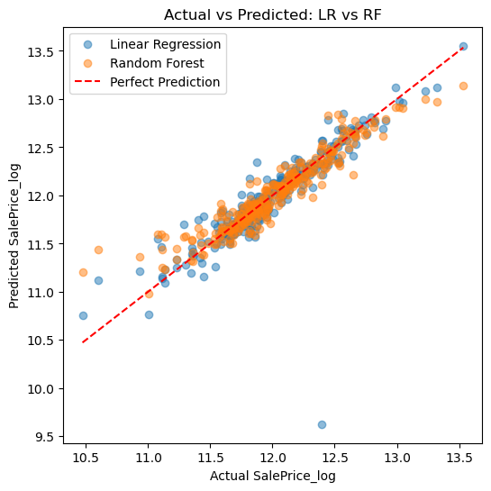
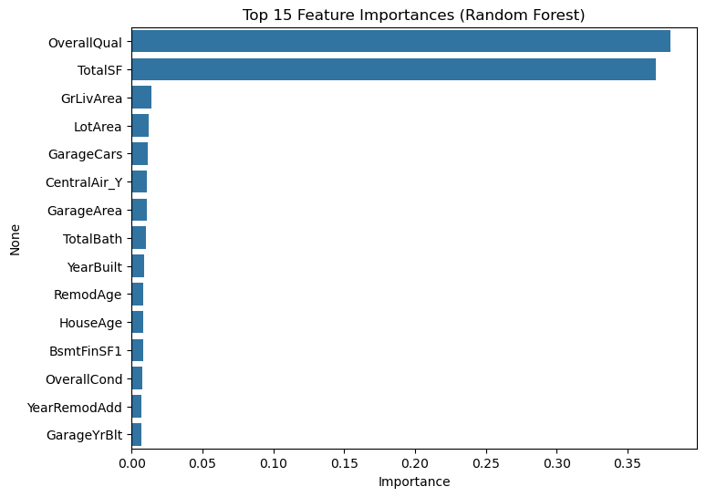
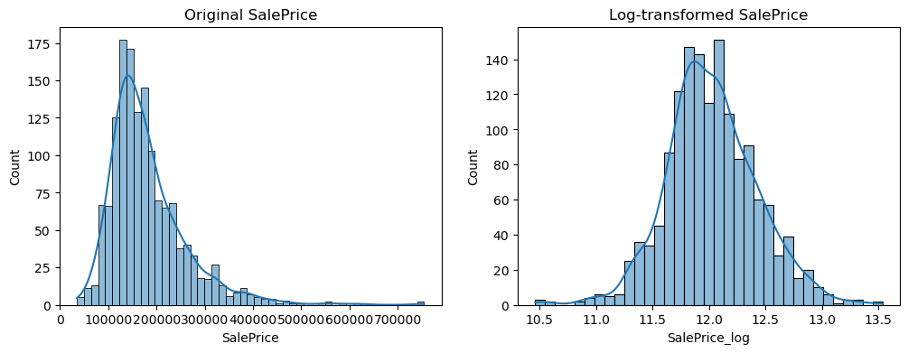
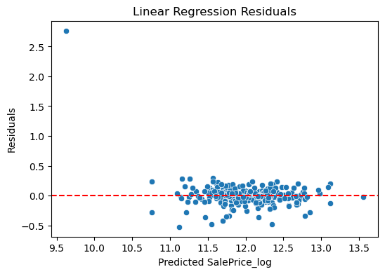

# Real Estate Price Prediction

> Predicting house sale prices from 80 property attributes, comparing two
> models — and finding that **neither one wins outright**. Which is better
> depends entirely on which kind of error you care about.


---

## Overview

1,460 house sales in Ames, Iowa, 80 attributes each — lot size, build quality,
basement finish, garage, neighbourhood, year sold. The job: predict
`SalePrice`, and work out which model to trust.

The pipeline runs end to end — cleaning, encoding, feature engineering,
training, evaluation — and then hands its predictions to a **Power BI
dashboard**, so the results are explorable by someone who will never open a
notebook.

---

## The headline result

| Metric | Linear Regression | Random Forest |
| --- | ---: | ---: |
| R² (log scale) | 0.778 | **0.885** |
| RMSE (log scale) | 0.2034 | **0.1463** |
| **RMSE in dollars** | **$25,933** | $30,158 |

**The Random Forest fits better and is wrong by more money.**

That is not a contradiction, and chasing it down is the most interesting part of
this project. The forest wins comfortably on the log scale it was trained on —
it captures non-linear interactions that a straight line cannot. But converted
back to dollars it loses by about $4,200 of RMSE.

### Why

Only **9 of 1,460 houses** sold above $500,000. A random forest predicts by
averaging the training examples in each leaf, so it structurally **cannot
predict a value higher than the most expensive house it has seen** — and with
nine examples at the top of the market, its leaves have almost nothing to
average. Linear regression extrapolates along a fitted slope and keeps going.

The single worst case in the test set makes it concrete:

| Actual sale price | Random Forest error | Linear Regression error |
| ---: | ---: | ---: |
| **$755,000** | **$247,891** | $15,833 |
| $611,657 | $182,091 | $110,907 |
| $556,581 | $114,178 | $73,339 |

On the most expensive house in the data, the forest is out by a quarter of a
million dollars. RMSE squares errors, so three failures of that size are enough
to swamp the forest's advantage across the other 289 houses.

**So which model?** For ranking properties or estimating a typical mid-market
home, the forest. For a portfolio where a single luxury property can distort the
total, linear regression. Reporting only R² would have hidden this entirely.



Both models track the diagonal closely through the middle of the market. The
spread opens up at the extremes — the low end on the left, where linear
regression throws out one badly wrong prediction, and the high end on the right.

---

## What drives price



| Rank | Feature | Importance |
| ---: | --- | ---: |
| 1 | `OverallQual` — overall material and finish quality | **0.380** |
| 2 | `TotalSF` — total square footage (engineered) | **0.370** |
| 3 | `GrLivArea` — above-grade living area | 0.014 |
| 4 | `LotArea` | 0.012 |
| 5 | `GarageCars` | 0.011 |

Two features carry **75%** of the model's decision-making, and everything after
them is noise by comparison. That matches how people actually value houses —
how big is it, and how well is it built — and it is a reassuring sanity check
rather than a surprise.

Worth noting: `TotalSF` is **engineered**, not supplied. Summing basement, first
and second floor areas produced the second most predictive feature in the
dataset, ahead of all 200-odd originals except quality.

---

## Method

| Step | Decision | Why |
| --- | --- | --- |
| **Missing values** | Four different strategies by reason, not one blanket fill | A missing `PoolQC` means *no pool*; a missing `LotFrontage` is genuinely unknown. Filling both the same way would be wrong in one of the two cases |
| **`LotFrontage`** | Median **within each neighbourhood** | Street frontage is a neighbourhood characteristic; a global median would flatten real variation |
| **`Utilities`** | Dropped | 1,459 of 1,460 rows identical — zero information |
| **Ordinal encoding** | Quality ratings → `Po 1 … Ex 5` | Excellent *is* better than Good; one-hot would throw that ordering away |
| **Nominal encoding** | One-hot for `Neighborhood`, `RoofStyle`, … | No natural order to preserve, and inventing one would be worse |
| **Target transform** | `log1p(SalePrice)`, trained on, then `expm1` back | Price is strongly right-skewed; a few mansions otherwise dominate the loss |
| **Features** | 4 engineered: `TotalSF`, `HouseAge`, `RemodAge`, `TotalBath` | `TotalSF` became the 2nd most important feature of 207 |
| **Split** | 80/20, `random_state=42` | 1,168 train / 292 test |
| **Models** | `LinearRegression`; `RandomForestRegressor(n_estimators=200)` | A linear baseline to beat, and a non-linear model to beat it with |
| **Evaluation** | R², RMSE in log units **and in dollars** | The dollar conversion is what exposed the disagreement above |

### Target transform



Raw `SalePrice` has a long right tail. `log1p` pulls it close to normal, which
is what both models assume and what makes the residuals interpretable.

### Residuals



Residuals are centred near zero and roughly symmetric, so the linear model is
not systematically over- or under-predicting. The tails are where the errors
live, which is the same story the dollar RMSE tells.

---

## Power BI dashboard

The notebook exports its test-set predictions to
`outputs/model_results_for_powerbi.csv`, and the dashboard reads that file —
so the report is driven by real model output, not by retyped numbers.

<!-- DASHBOARD SCREENSHOT
     Export the page from Power BI Desktop into assets/screenshots/
     (see assets/screenshots/README.md), then delete this comment wrapper.

<p align="center">
  
  <br><sub><strong>Model Performance</strong></sub>
</p>
-->

**Page: Model Performance**

| Element | Shows |
| --- | --- |
| KPI cards | RF RMSE · LR RMSE · RF R² · Average sale price |
| Column chart | Average sale price by neighbourhood |
| Bar chart | Top 10 Random Forest feature importances |
| Table | Prediction error by neighbourhood, with an **RF Advantage %** measure |
| Scatter ×2 | Actual vs predicted, one per model, side by side |

The per-neighbourhood error table is the part the notebook cannot easily
replace: it turns "which model is better" into "which model is better **here**",
which is the question someone pricing a specific property would ask.

Open `powerbi/real-estate-dashboard.pbix` in
[Power BI Desktop](https://powerbi.microsoft.com/desktop/) (free, Windows). On
macOS or Linux, upload the `.pbix` to [app.powerbi.com](https://app.powerbi.com)
with a Microsoft work or school account.

---

## Running it

```bash
git clone https://github.com/YOUR_GITHUB_USERNAME/real-estate-price-prediction.git
cd real-estate-price-prediction
pip install -r requirements.txt
jupyter notebook notebooks/real-estate-price-prediction.ipynb
```

Run all cells top to bottom — about a minute, most of it fitting the forest.
`random_state=42` is set on both the split and the model, so every number above
reproduces exactly.

The final cell writes both fitted models into `models/`. Those are **not
committed** — the forest pickle is ~20 MB and only loads reliably under the
scikit-learn version that wrote it. See [models/README.md](models/README.md).

---

## Project structure

```
real-estate-price-prediction/
│
├── README.md
├── LICENSE
├── requirements.txt
│
├── notebooks/
│   └── real-estate-price-prediction.ipynb
│
├── data/
│   ├── train_data.csv              1,460 sales with SalePrice
│   ├── test_data.csv               1,459 Kaggle holdout rows
│   ├── data_description.txt        the original Ames column reference
│   └── data-dictionary.md          cleaning, encoding and engineering decisions
│
├── outputs/                        written by the notebook, read by Power BI
│   ├── model_results_for_powerbi.csv   292 test rows with both models' predictions
│   └── feature_importances.csv         all 207 features ranked
│
├── models/                         .pkl files are git-ignored; see README there
│
├── powerbi/
│   └── real-estate-dashboard.pbix
│
└── assets/
    ├── actual-vs-predicted.png
    ├── feature-importances.png
    ├── log-transform.png
    ├── residuals.png
    ├── saleprice-distribution.png
    └── screenshots/                dashboard export
```

---

## Data

Ames Housing — 1,460 residential sales in Ames, Iowa, 2006–2010, 25
neighbourhoods, 80 attributes. Sale prices run $34,900 to $755,000 with a median
of $163,000. 19 columns carry missing values, handled four different ways.
After cleaning and encoding: **207 features**.

Full detail on every cleaning and encoding decision:
[data/data-dictionary.md](data/data-dictionary.md).

> De Cock, D. (2011). *Ames, Iowa: Alternative to the Boston Housing Data as an
> End of Semester Regression Project.* Journal of Statistics Education, 19(3).

---

## Limitations

- **One town, five years, 1,460 sales.** Ames is a university town in Iowa; the
  price drivers here will not transfer to a coastal metro.
- **The high end is unmodelled.** Nine sales above $500K is not enough to learn
  from, and it is the direct cause of the Random Forest's dollar error.
- **No hyperparameter search.** `n_estimators=200` and otherwise defaults; a
  tuned gradient-boosting model would very likely beat both.
- **No cross-validation.** Every number comes from a single 292-row test split,
  so there is no error bar on any of them. *(This is the gap I would close
  first.)*
- **The Kaggle test set is unused** — it has no labels, so the notebook loads it
  but does not score against it.
- **2006–2010 covers the housing crash**, and no feature marks where a sale
  falls relative to it.

---

## Possible next steps

| | Enhancement | Why |
| --- | --- | --- |
| 1 | K-fold cross-validation | Single-split numbers have no error bar — the most important gap |
| 2 | Gradient boosting (XGBoost / LightGBM) | Usually the strongest family on tabular data like this |
| 3 | Hyperparameter search | Both models run on near-defaults |
| 4 | Log-scale evaluation for the business metric too | Or weight the loss, so the high-end failure is handled rather than just reported |
| 5 | Ensemble the two models | Linear regression extrapolates, the forest handles interactions — blending plays to both |
| 6 | SHAP values | Per-property explanations instead of one global importance ranking |
| 7 | Submit to the Kaggle leaderboard | `test_data.csv` and the submission format are already here |

---

## Author

**Priyal Parmar**

[](https://linkedin.com/in/priyal-parmar-0b60a71b2)
[](https://github.com/priyalparmar-analytics)
[](mailto:priyalparmar1511@gmail.com)
